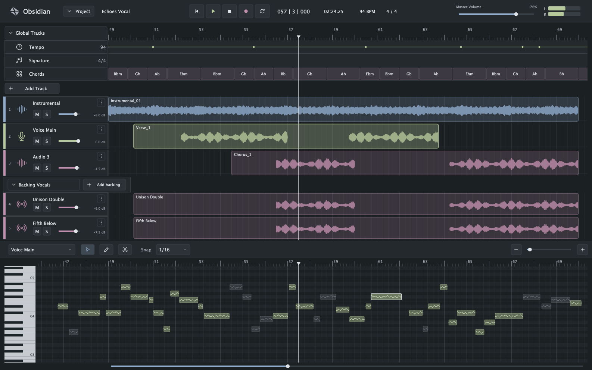
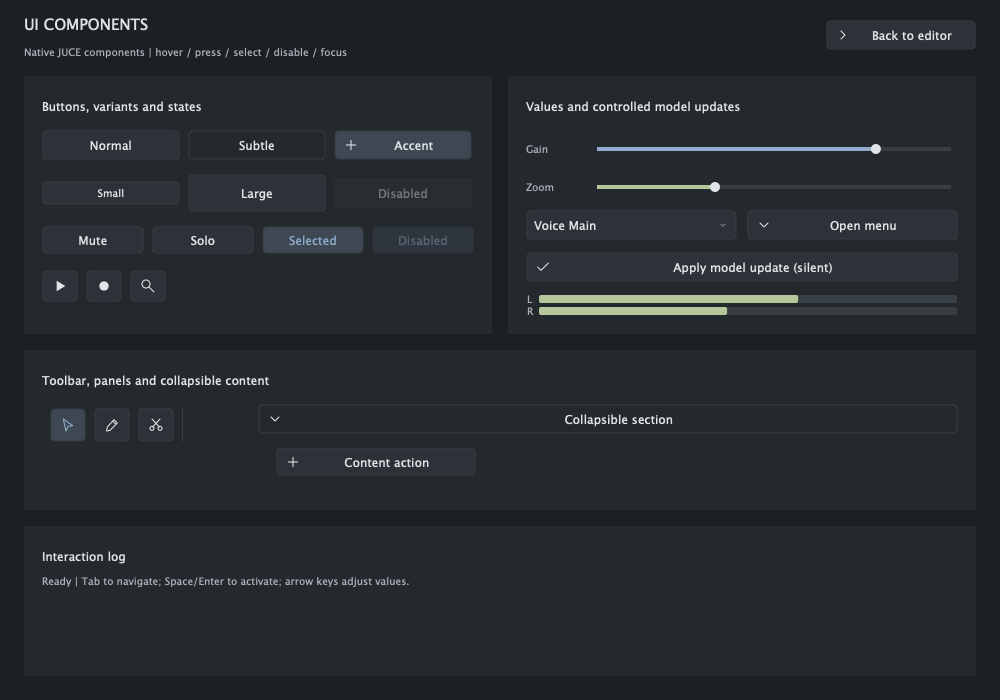

# Obsidian native UI kit

A reusable C++20/JUCE 8 UI library, editor component layer, interactive control gallery, and native editor demonstration based on the supplied Obsidian reference. The demo uses deterministic synthetic data. It does not open audio devices, process audio, load models, or replace the existing React application/plugin editor.

## Build and run

```sh
cmake -S . -B build-uikit \
  -DSYNTHETIC_OBSIDIAN_UIKIT_ONLY=ON \
  -DCMAKE_BUILD_TYPE=Release -DBUILD_TESTING=ON
cmake --build build-uikit --config Release \
  --target ObsidianUIKitDemo ObsidianGallery ObsidianUIKitTests --parallel 4
ctest --test-dir build-uikit -C Release --output-on-failure
```

`UIKIT_ONLY` bypasses frontend assets and all product audio/ML targets. It also leaves macOS architecture/deployment settings configurable, independently of the product's Apple Silicon restriction. Universal builds can pass `-DCMAKE_OSX_ARCHITECTURES="arm64;x86_64"`.

Apps are in `build-uikit/tools/uikit_demo/<target>_artefacts/<configuration>/`. On macOS open the `.app`; Windows uses `.exe`; Linux uses the executable. The gallery is also accessible through **Project → Component gallery** or **G**, with a **Back to editor** action.

Linux dependencies and the Windows/macOS/Linux matrix are in `.github/workflows/uikit.yml`. Linux tests use `xvfb-run` when no display is available.

## Targets and boundaries

- `Obsidian::UIKit` (`Source/uikit`): custom `Component` controls, theme tokens, vector icons, layout containers, menus/popovers/tooltips. It depends only on JUCE GUI modules.
- `Obsidian::EditorUI` (`Source/editor_ui`): transport, track/group headers, timeline lanes, clip waveform, keyboard, pitch editor, playhead. No project model or audio dependency.
- `ObsidianDemoViews`: demonstration data and composition, separate from the reusable libraries.
- `ObsidianUIKitDemo`, `ObsidianGallery`: independent native application entry points.
- `ObsidianUIKitTests`: notification, gesture, accessibility, lifecycle, geometry, and composed demo checks.

To embed the library in another JUCE project, add `Source/uikit` (and optionally `Source/editor_ui`) as CMake subdirectories after defining the JUCE targets, then link the corresponding alias. Public headers include JUCE modules directly; there is no generated `JuceHeader.h` dependency. All custom controls paint their own surfaces. No `LookAndFeel` customization is used. JUCE provides native windows, focus/accessibility infrastructure and the clipped `Viewport` container.

## Theme and adding controls

`uikit/Theme.h` contains graphite surfaces, semantic text colours, track accents, font sizes, spacing, corner radius, and control heights in logical pixels. JUCE handles the display backing scale. Fonts use the platform's default UI face; small font-metric differences between OSes are expected. `Theme.cpp` draws resolution-independent icons. Editor-specific layout proportions are local to the composed view.

A new control should derive from `juce::Component` (or an existing custom control), consume these tokens, implement hover/pressed/selected/disabled appearance and `drawFocus`, and expose explicit model setters and callbacks. Give interactive components a title and an accessibility role/actions/value interface. Add the control to the gallery and a test for any new notification or gesture semantics. Keep geometry generation outside `paint()`.

```cpp
obsidian::ui::Slider gain;
gain.setRange(-60.0, 6.0, 0.1);
gain.valueToText = [](double value) { return juce::String(value, 1) + " dB"; };
gain.setValue(-8.0); // silent model -> view update
gain.onDragStart = [] { /* begin an application undo/parameter gesture */ };
gain.onValueChange = [](double value) { /* update external model */ };
gain.onDragEnd = [] { /* close gesture, including cancellation */ };
```

## Interaction contract

All components, setters, callbacks, layout and geometry belong to the **message thread**. No UI method is audio-thread safe. A future audio integration must publish bounded snapshots/scalars outside the audio callback; this library does not add such an integration.

- Setters default to `dontSendNotification`. Explicit synchronous and asynchronous notifications are supported by value controls. Duplicate normalized values do not emit another change. Asynchronous delivery uses weak component handles.
- Buttons: Tab focus, Space/Return activation. Toggle state is observable by accessibility.
- Sliders: drag, wheel, arrows, Home/End. Keyboard/wheel/accessibility changes form complete begin/change/end gestures. Escape, focus loss, hide, disable, destruction and lost mouse capture terminate drags. Cancellation retains the last value; owners may implement undo from gesture boundaries.
- Select/menu: arrow navigation, Enter/Space opening or activation, Escape/outside-click dismissal, disabled items skipped, focus returns to the anchor. Overflow menus scroll with the wheel and keep keyboard selection visible.
- Tooltips appear on hover or keyboard focus; descriptions remain available to accessibility.
- Timeline: click/drag to seek; wheel pans time; Control/Command+wheel zooms around the cursor. Wheel over track headers/background scrolls the track list vertically. The bottom position slider also pans time. Header and clip rows share one scroll container.
- Pitch editor: pointer selects; Up/Down cycles notes; Escape clears selection. Pencil inserts a note, scissors splits at the snapped position, Delete removes selection. Snap Off preserves exact click position. Edits only change the demo's note vector.
- Play/Stop/Space operate a visual playback clock. Record arms a visual state, Loop repeats beats 192–276, meters are synthetic. Track M/S and gain update demo state; M also dims the clip. Add Track/Add backing create demo rows. Project Save/Open uses an in-memory note snapshot; Export increments a simulated export counter.

## Time and rendering

Musical time is expressed in zero-based quarter-note beats. `TimeViewport` supplies one beat-to-pixel transform. The lower viewport is derived from the canonical arrangement viewport with an origin offset for its narrower keyboard gutter; a given beat therefore has the same absolute horizontal coordinate in both views. Call `viewportChanged()` on surfaces after changing the transform and `setCurrentBeat()` after external seeking/playback updates so keyboard seeking uses the same position.

`AudioClipData::peaks` and `NoteSegment::pitchOffsets` are supplied by the owner. Visible waveform and pitch geometry is cached on data/layout/viewport changes. Rendering does not perform file I/O, analysis, or rebuild geometry, and there is no per-sample/per-note component tree. Playhead updates invalidate narrow strips. Static demo views do not run a frame timer; playback runs at a requested 60 Hz using elapsed time. This is not a claim of measured frame-time performance on every GPU/host.

## Visual QA

The app can export its actual JUCE component rendering (not a separate HTML mock):

```sh
<demo-executable> --snapshot /absolute/path/demo.png --width 1586 --height 992
<demo-executable> --snapshot /absolute/path/demo-2x.png --scale 2
<gallery-executable> --snapshot /absolute/path/gallery.png --width 1000 --height 700
```

Snapshots exit after writing the PNG. Interactive windows support 1000×700 and larger. Verify the compact layout, aligned playhead, text at different backing scales, all states in the gallery, menu focus restoration and repeated gesture cancellation. Automated tests and CI results are reported separately from manual platform checks.

## Preview and evidence





See [validation notes](VALIDATION.md) for tested scope and limitations.
